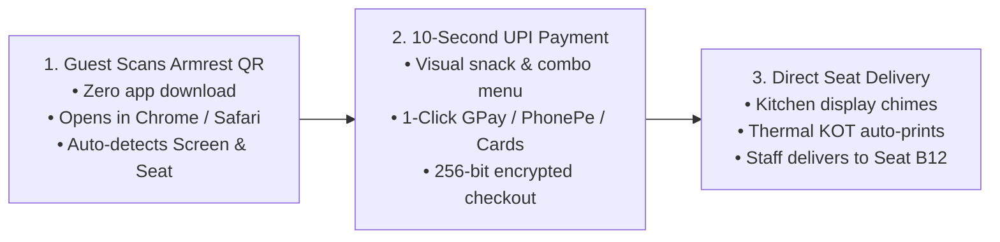
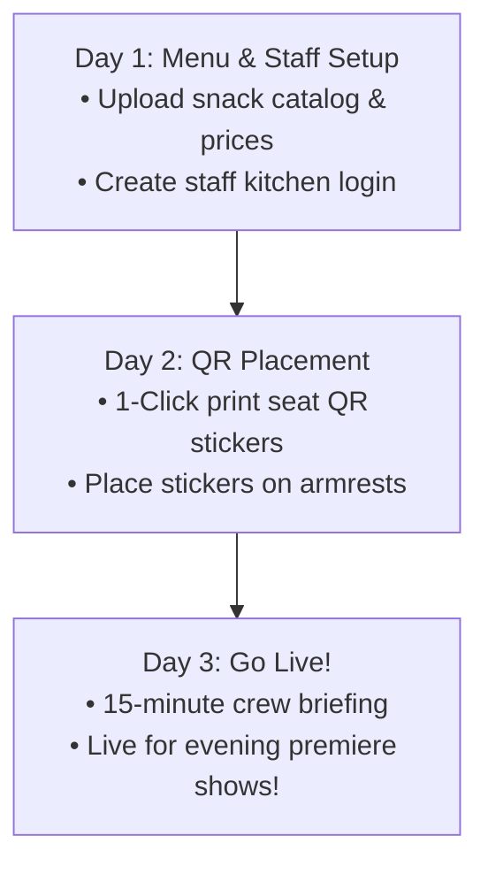

# GRANDE MUTHURAM MULTIPLEX
## *Smart In-Seat Concession & Luxury Dining Platform*

---

> [!IMPORTANT]
> **Executive Summary for Cinema Management**:
> Every screening at Grande Muthuram Multiplex loses 50%+ of potential snack sales because guests refuse to stand in crowded 10-minute interval queues. **Our Smart In-Seat QR Ordering Platform turns every armrest into an instant concession counter**, allowing guests to order hot butter popcorn, nachos, and chilled drinks directly to their seat in 10 seconds via Google Pay / PhonePe &mdash; **boosting concession turnover by +35% to +45% with zero extra staff.**

---

## 1. The 3-Step Simple Customer Journey



---

## 2. Why Grande Muthuram Multiplex Makes More Money

| Operational Metric | Traditional Snack Counter | Grande Muthuram In-Seat QR Platform |
| :--- | :--- | :--- |
| **Ordering Window** | Only 10-minute intermission rush | **All Show Long** (Pre-show, Runtime & Interval) |
| **Average Order Value (AOV)** | ₹180 &ndash; ₹220 per bill | **₹290 &ndash; ₹360 (+40%)** (Visual Combos prompt upselling) |
| **Customer Drop-Off** | High (Guests walk away to not miss movie) | **Zero Lines &mdash; 100% seat comfort & VIP luxury** |
| **App Download Barrier?** | Yes in standard apps (90% abandon) | **No App Required** (Instant browser load in 1 second) |
| **Payment Speed** | Slow cash counting & POS queue | **Instant 10-second UPI** (GPay, PhonePe, Paytm, Cards) |
| **Staff Pressure & Chaos** | Extreme chaos for 12 mins, then idle | **Smooth digital queue with audio alert & auto-printed ticket** |

---

## 3. High-Margin Concession Menu Showcase

| Category | Concession Item | Guest Experience & Description |
| :--- | :--- | :--- |
| **Popcorn** | **Classic Butter & Caramel Crunch** | Warm gourmet cinema butter kernels or crunchy golden brown-sugar caramel tubs. |
| **Hot Snacks** | **Loaded Jalapeño Queso Nachos** | Crispy corn tortilla triangles accompanied by warm cheddar cheese sauce & salsa dip. |
| **Refreshments** | **Fountain Sodas & Hazelnut Cold Coffee** | Ice-cold 750ml fountain Pepsi, virgin mint coolers, and rich blended iced espresso. |
| **Combos** | **Blockbuster Family Combos for 2** | 1x Jumbo Popcorn + 2x Drinks combo bundle that lifts average transaction value by 40%. |
| **Bites** | **Savory Rolls, Wraps & Samosas** | Tandoori paneer ciabatta rolls, crispy chicken wraps, and golden cocktail samosas. |
| **Standards** | **FSSAI Transparent Dietary Badges** | Official Indian cinema green dot for Vegetarian and red triangle for Non-Vegetarian. |

---

## 4. Kitchen & Staff Operations (Dead Simple for Crew)

```
┌────────────────────────────────────────────────────────┐
│             GRANDE MUTHURAM MULTIPLEX                  │
│               KITCHEN ORDER TICKET (KOT)               │
├────────────────────────────────────────────────────────┤
│ ORDER #: #GM-90214          DATE: TODAY                │
│ AUDITORIUM: SCREEN 1        SEAT: RECLINER B12         │
├────────────────────────────────────────────────────────┤
│ QTY  ITEM                                 AMOUNT       │
│ 1    Butter Popcorn (Large)               ₹290         │
│ 2    Fountain Pepsi (750ml with Ice)      ₹320         │
│ 1    Cheese Loaded Nachos (with Salsa)    ₹240         │
├────────────────────────────────────────────────────────┤
│ TOTAL PAID (UPI - GPAY):                  ₹850         │
│ PAYMENT STATUS:                           VERIFIED ✓   │
├────────────────────────────────────────────────────────┤
│ INSTRUCTION: DELIVER TO SCREEN 1, SEAT B12             │
└────────────────────────────────────────────────────────┘
```

1. **Audible Chime Alert**: The kitchen tablet sounds an audible chime the instant an order is paid. Staff never needs to constantly watch the screen.
2. **Auto Thermal Ticket Print**: Automatically prints the exact slip above on standard 80mm or 58mm thermal receipt printers over local LAN.
3. **One-Touch Fulfillment**: Staff clicks `Start Preparation`, packs the tray, and the usher delivers directly to **Screen 1, Seat B12**.

---

## 5. Financial ROI Projections for Grande Muthuram

- **Weekend Footfall**: In a typical 4-screen multiplex weekend with ~1,500 admissions:
  - If just **200 seated guests** who usually skip the long counter line order snacks from their armrests:
  - $200 \times ₹300\text{ average spend} = \mathbf{₹60,000\text{ additional revenue per weekend}}$!
- **Monthly Revenue Surge**: Generates **₹2.4 to ₹3.5 Lakhs in additional monthly concession profits**.
- **Hardware Cost**: **₹0**. Works with any tablet, Android phone, or counter PC already installed.

---

## 6. Turnkey 48-Hour Implementation



---

*Grande Muthuram Multiplex &middot; The Future of In-Seat Cinema Dining.*

